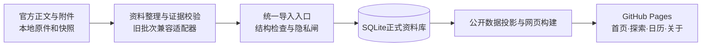

# 体系架构与边界 · v1

目标：资料增加、维护者更换、页面扩展时，不必重做数据，也不让历史批次和页面互相牵连。当前采用一个数据库、一个维护入口、一个静态站点。本地数据仓储不是在线后端。

## 四层结构

1. 来源层：原文件和官网快照保持原位，正文、附件与取得时间可追溯；私人证据不随公开数据输出。
2. 数据层：活动与公告分开；ID、关联、事实、时间和词表使用统一含义。
3. 内容层：证据决定事实能否采用；参与价值决定是否推荐，两种判断互不替代。
4. 展示层：所有页面共享同一公开投影，详情保留完整事实。月份探索复用日历月份规则。

## 正式存储结构

| 表 | 含义与边界 |
|---|---|
| activities | 活动或已确认系列，可关联多个年度/轮次 |
| notices | 每份独立公告；时间、参与对象和规则不得跨公告拼接 |
| sources | 官方来源URL唯一，保留有效查询参数 |
| facts | 公告的分条事实、原文引句、定位与附件依据类型 |
| profiles | 对应公告的完整公开条款、附件入口与覆盖提示 |
| taxonomy / notice_taxonomy | 学院与级别词表、公告关联 |
| catalog_metadata / site_documents | 展示兼容元数据与已公开依据，禁止私人材料 |
| revisions / current_state / changes | 批次、当前版本、修改原因、变更指纹、压缩恢复快照 |

SQL列管理可查询的核心字段；JSON保留兼容扩展字段、条款与字段顺序，不再存核心列的第二份值。导出按原接口组装，网页不读取SQL结构，数据库不存网页DOM或CSS。

`user_version=1` 是数据库结构版本；`catalog-1` 是公开接口版本；`rev-…` 是内容修订版本，三者分别管理。网页原有“数据库版本：2026.10.16”按用户指定保留，本次未擅自更换。

## 字段含义

| 概念 | 规则 |
|---|---|
| 活动ID | 保留现有ID，不因改标题重编号；仅确认同系列后关联公告 |
| 公告ID | 从来源URL生成；调整所属系列后仍保持身份 |
| 事实ID | 由所属公告与完整事实内容生成，前面插入条款不改变已有ID |
| 发布时间 | 仅原文时间，不是文件日期、采集时间或报名开始 |
| 报名 / 提交 / 举办 | 分别记录；日期不全保留原句，不补年份 |
| 举办级别 | 与报名范围分开；全国赛事的校内选拔可同时有两个级别 |
| 组织相关学院 | 既有colleges / college_role；主承办关系不等于参加资格 |
| 明示参与范围 | audience_scope只依据参与对象，仍保留年级、专业等条件 |
| 原文事实 | value / quote / locator / source_url，有依据才进入正式资料 |
| 整理建议 | 明确标注建议，不作为条件、日期或规则依据 |

未知值用null。原文未写、附件未读、来源冲突、损坏不可读分别在来源层记录。冲突可只隔离某个字段，其余有依据的信息仍可展示。不得把采集困难变成整条“详见原文”。

## 内容质量与展示优先级

收录条件：学生能参与，有明确参与行动，能追溯来源。纯结果报道、行政会议、名单、教师专属事务和纯宣传不进入活动列表，原件保留。

精选考虑：对象是否明确，行动是否具体，是否值得提前准备，正文信息是否足够支持参与判断。小活动不自动低质，大比赛不自动精选。讲座、零散提醒和有限人群通知不默认占据精选。

本次沿用已上线精选，没有借迁移重新评判484个活动。精选规则现由内容适配器生成，数据库保存结果；不能绕过规则直接写库。后续调整精选标准应单独变更和检查，不混在结构迁移中。

历史公告永久可检索；“往年十月出现过”和“今天仍能报名”是不同视图。只有原文明示报名期才进入当前报名，不凭往年规律推断今年安排。

## 更新与恢复

- 导入必须有批次编号、原因和预期基线，过期基线拒绝覆盖。
- 全批结构、来源、日期、关联与隐私检查后，在一个事务中更新。
- 失败撤销整批；重复内容返回unchanged，不新增修订。
- 默认不允许移除历史公告；确需移除时显式开关并记录原因，旧修订可恢复。
- 每次保存活动级变更指纹与压缩快照；回退生成新修订，不擦除历史。
- 适配器更新前自动备份，另有独立备份命令；目前仅本机备份，没有异地灾备。
- 构建前校验内容与修订哈希，绕过入口修改SQL会被阻止导出。

结构检查不能证明事实真实性或官方授权。旧适配器仍执行正文定位、附件证据、数字与日期规则；不能把任意JSON直接入库，也不能把结构通过称为已核实。

## 运行、安全与扩展边界

目前不增加服务器、登录、评论、在线投稿、用户追踪或在线AI代理。浏览器只读公开文件，SQLite不上传Pages。SQL使用参数绑定；网页内容通过textContent展示，嵌入JSON转义小于号等字符。

GitHub写权限只给发布执行者，整理代理交数据包。凭据不进入源码、数据库或交付包。来源限制学校域名，但域名范围不能代替内容核验。事务和快照防误操作，不防已获得本机写权限的恶意篡改。

出现多人在线编辑再加后台与权限；需要跨设备收藏再加账号；静态检索实测成为瓶颈后再考虑在线查询。届时保留活动、公告、事实ID和公开接口，替换存储或托管层，不预先拆分微服务。
